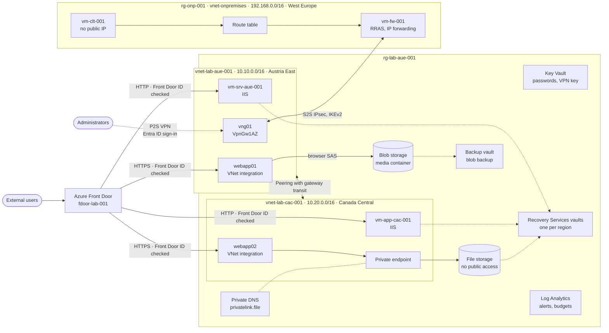

# Azure hybrid network: Terraform

A hybrid Azure lab built as code: two peered Azure VNets in different regions, connected over site-to-site VPN to a simulated on-premises network. Front Door and point-to-site VPN are the only ways in.

It replaces a provided Azure CLI script that didn't run as delivered and built only part of its own architecture diagram. The [improvement story](docs/improvement-story/README.md) has the before-and-after.

> **Status:** `terraform validate`, TFLint, Checkov and 11 mock-provider tests pass. It has **not** been applied to Azure yet.

## Architecture



### How traffic is controlled

| Path | Allowed by |
|---|---|
| Internet to apps | Front Door only. NSGs allow 80/443 from the `AzureFrontDoor.Backend` tag, and IIS and App Service also require this profile's `X-Azure-FDID` header. |
| Admin to VMs | P2S VPN or on-premises only. RDP is never open to the internet, and a test enforces it. |
| Canada VNet to on-premises | Peering with gateway transit through `vng01`. |
| On-premises to Azure | Route table pointing to `vm-fw-001`, which runs RRAS. |
| Everything else inside the VNets | Denied by an explicit rule that overrides Azure's implicit `AllowVnetInBound`. |
| File share | Private endpoint only, with public network access disabled. |

## Repository layout

```text
.
├── infra/
│   ├── bootstrap/          # Remote state storage (Entra ID auth, versioning, delete lock)
│   ├── envs/lab/           # Root module and tests/architecture.tftest.hcl
│   ├── modules/            # network, windows_vm, web_app, hybrid_vpn, storage, front_door, backup
│   └── scripts/            # PowerShell for IIS and RRAS, run through Azure Run Command
├── docs/
│   ├── analysis-and-improvement-plan.md
│   └── improvement-story/
└── .github/workflows/terraform.yml
```

## Quick start

You need Terraform 1.10 or later, Azure CLI, and Owner on the subscription. The full steps are in [infra/README.md](infra/README.md).

```bash
terraform -chdir=infra/bootstrap init && terraform -chdir=infra/bootstrap apply -var owner=your-name
```

```bash
terraform -chdir=infra/envs/lab init -backend-config=backend.hcl
```

```bash
terraform -chdir=infra/envs/lab plan -var-file=lab.tfvars -out=lab.tfplan
```

Review the plan before applying it. The VPN gateway and VMs bill from the moment they exist. Set `vpn_enabled = false` to leave out the gateway, the largest cost, and see [infra/README.md](infra/README.md) for the two-step way to turn it off later.

## Testing

The tests run without Azure access, because the providers are mocked:

```bash
terraform -chdir=infra/envs/lab init -backend=false && terraform -chdir=infra/envs/lab test
```

They check the defects that were fixed: gateway transit, no internet RDP, the explicit VNet deny rule, Standard SSD disks, a private file share, regional backup vaults, and the two-step VPN shutdown. Deliberately breaking each of these makes the suite fail, as recorded in [after-evidence.txt](docs/improvement-story/after-evidence.txt).

CI runs format, validate, tests, TFLint and Checkov on every pull request. Plans run on `main`, and an apply is a manual workflow run that needs approval.

## Known limits

- **Not yet applied to Azure,** and the PowerShell scripts have never run.
- **Lab-grade by design:** single VMs, B1 App Service plans, LRS storage, and plain HTTP from Front Door to the VMs.
- **Accepted risks:** 16 Checkov exceptions, each with a reason in [infra/README.md](infra/README.md#accepted-risks).
- **Not included:** a database server, custom domains, and a DNS Private Resolver.
