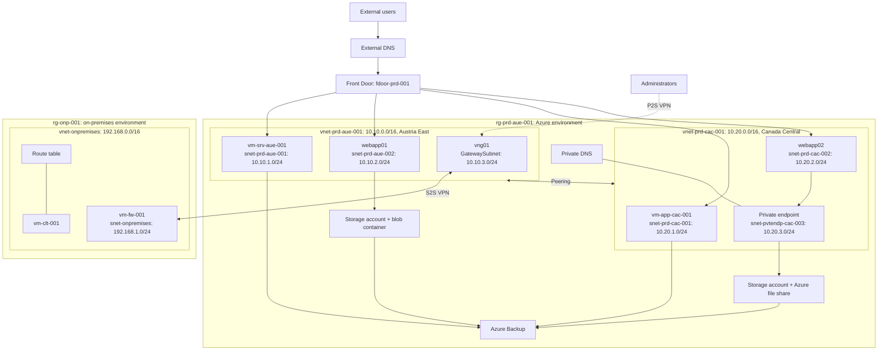

# Azure hybrid network: analysis and Terraform improvement plan

Status: implemented in `infra/` and passing static checks, but not applied to Azure. Resources were later renamed from `prd` to `lab`. This is the plan as it was written, so see [the improvement story](improvement-story/README.md) for what changed during the build.

## 1. What the project is

A lab that simulates a hybrid environment across three Azure regions:

- **Azure side:** two peered VNets (Austria East and Canada Central) with IIS VMs, App Service apps, storage and private access.
- **Simulated on-premises:** a third VNet in West Europe, connected by site-to-site VPN through a Windows VM acting as the firewall.
- **Entry points:** Azure Front Door for external users, point-to-site VPN for administrators.

### Target architecture (redrawn from the original diagram, using the script's names)



The source diagram is low resolution. `vm-clt-001` is my best reading of that label, and the Front Door and storage connections are simplified. Check them against the original.

## 2. Coverage: script compared with diagram

| Area | Diagram | Script | Gap |
|---|---|---|---|
| Resource groups, 3 VNets, 7 subnets | Yes | Yes | Names differ (section 3, D6) |
| Peering | Yes | Partial | No gateway transit |
| NSGs | Not drawn | Yes, 2 | No rules at all |
| App Service plans | Implied | Yes, 2 | No apps, so the plans bill while unused |
| VMs | 4 | 3 | `vm-clt-001` missing |
| VPN gateway, S2S, P2S, local gateway | Yes | No | Missing |
| On-premises route table | Yes | No | Missing |
| Web apps and VNet integration | Yes | No | Missing |
| Front Door and DNS | Yes | No | Missing |
| Storage, blob, file share | Yes | No | Missing |
| Private endpoint, Private DNS | Yes | No | Missing |
| Azure Backup | Yes | No | Missing |
| SQL Server (needed by the ticketing app) | No | No | Missing from both |

The scripts build only the foundation. Everything else was evidently done by hand, so most of the target architecture has no code behind it.

## 3. Findings

Verification key: **Tested** means I ran a check on the source file or provider schema. **Read** means it follows directly from the source text. **Docs** means Azure documented behaviour, not tested against a live subscription, because Azure CLI is not logged in here.

### Defects

| ID | Severity | Finding | Basis |
|---|---|---|---|
| D1 | High | The original script does not parse as delivered. CRLF line endings produce a `bash -n` syntax error at `create_vm () {`. It passes once CRLF is removed. | Tested |
| D2 | High | Peering omits `allow_gateway_transit`, `use_remote_gateways` and `allow_forwarded_traffic`, so the Canada VNet cannot reach on-premises or P2S clients through `vng01`. | Read, Docs |
| D3 | High | The subnet NSGs have no rules. With no NIC NSG, the two production VMs reject all inbound internet traffic, including RDP and Front Door, despite having public IPs. | Read, Docs |
| D4 | High | `vm-fw-001` gets the `az vm create` default NIC NSG, which opens RDP to the internet. | Read, Docs |
| D5 | Medium | The requirements ask for `Standard_SSD` on VM1, but the script never passes `--storage-sku`, so the disk type is left to the CLI default. | Tested |
| D6 | Medium | The diagram and script disagree: `vnet-prd-cac-001` appears twice in the diagram, the 10.10 VNet is `aue` in the script, the resource group is `rg-prd-cac-001` versus `rg-prd-aue-001`, and the gateway subnet is drawn as `snet-prd-cac-003` although Azure requires the name `GatewaySubnet`. | Read |
| D7 | Medium | `vm-fw-001` routes on-premises traffic but has no NIC IP forwarding, and no route table exists. | Tested, Read |
| D8 | Low | The shebang is on line 2 so it is ignored, and a stray ` `` ` on the last line is left over from a Markdown fence. | Tested (ShellCheck SC1128, SC2092) |
| D9 | Low | The requirements ask for tags on peering. The provider schema has no `tags` on peerings or subnets, so this cannot be met. | Tested |
| D10 | Low | `onpremisses` is misspelled in the script, while the diagram uses `onpremises`. | Read |

### Script and process weaknesses

- **No state:** there is no drift detection, preview, dependency graph or clean teardown. A mid-run failure leaves a partial deployment.
- **Manual password entry:** passwords are prompted once per VM and passed as a command-line argument.
- **Hard-coded values:** the admin username is a person's name, and the image version is `latest`.
- **Manual app setup:** IIS and the applications are installed by hand over RDP, so a rebuilt VM loses them.
- **Tag quality:** the `Environment` tag holds a program name rather than an environment, and nothing enforces tagging.

### Application security (from the linked guides)

| Severity | Finding | Recommendation |
|---|---|---|
| High | The gallery uses a default admin password with an account SAS (including write and delete) entered in the browser, and an example one-year expiry. | Prefer Entra ID sign-in with Storage Blob Data RBAC. At minimum use a short-lived, container-scoped SAS. |
| High | The ticketing app guide publishes default application and SQL credentials, and stores database credentials in `.env`. | Generate unique secrets, store them in Key Vault, and never reuse the guide's values. |
| High | `IUSR` and `IIS_IUSRS` get FullControl on the API folder. | Grant read and execute, plus write on `logs` only. |
| Medium | CORS is `*` on Blob and suggested for the API. | Limit it to the real application origin. |
| Medium | GitHub deployment uses a long-lived publish profile. | Use OIDC federated credentials. |
| Medium | ZIP packages are downloaded with no pinned version or hash. | Host a known copy and verify a SHA-256 hash during bootstrap. |

### Architecture constraints

- **VPN SKU:** new non-AZ VPN gateways (`VpnGw1`) can no longer be created, so use `VpnGw1AZ` with a Standard public IP.
- **Backup is regional:** Recovery Services vaults must be in the same region as the VMs and file shares they protect. One "Azure Backup" box becomes one vault per region. Blob backup uses a separate Backup vault.
- **The gallery needs browser-reachable storage:** the SPA calls Blob Storage from the visitor's browser, so its account cannot be private-endpoint-only without adding a backend. This matches the diagram, which puts the private endpoint on the second account. Keep them separate.
- **Web apps are not inside subnets:** VNet integration needs a dedicated subnet delegated to `Microsoft.Web/serverFarms` and covers outbound traffic only. Inbound control comes from access restrictions.
- **Front Door Standard needs public origins:** the VMs keep public IPs in this design, limited to the `AzureFrontDoor.Backend` service tag. That tag is shared across customers, so also validate `X-Azure-FDID`.
- **Default outbound access:** VNets created through API versions after 31 March 2026 get private subnets by default. VMs without a public IP, such as `vm-clt-001`, need explicit outbound access.
- **State contains secrets:** in `azurerm` 5.12 the VM `admin_password` and VPN `shared_key` have no write-only variants (schema tested), so both are stored in state. The state backend must be treated as a secret store.

## 4. Improvement suggestions

### Must do

1. **Replace the scripts with Terraform:** cover the full diagram, not just what the scripts create.
2. **Protect remote state:** Azure Storage backend with Entra ID authentication, versioning, no public access and locking.
3. **Remove internet RDP:** administrators use P2S VPN. `vm-fw-001` allows RDP only from one `admin_source_cidr` during setup.
4. **Define NSG rules as code:** default deny, with 80/443 from `AzureFrontDoor.Backend` only. Add IKE (UDP 500/4500) from the gateway IP on the on-premises side.
5. **Fix hybrid routing:** gateway transit on both peering directions, IP forwarding on `vm-fw-001`, and a route table for 10.10/16, 10.20/16 and the P2S pool.
6. **Generate secrets:** use `random_password` and Key Vault, with a different password per VM and no personal username.

### Should do

7. **Automate VM setup:** bootstrap IIS and applications through Run Command with versioned PowerShell, instead of manual RDP.
8. **Add the missing services:** Front Door, private endpoint with Private DNS links to both VNets, and regional backup vaults.
9. **Add CI:** `fmt`, `validate`, `tflint`, `checkov` and `terraform test` on every pull request, plan on review, manual approval for apply, and OIDC instead of stored secrets.
10. **Control costs:** a `vpn_enabled` toggle for the gateway, VM auto-shutdown, a resource-group budget alert, and an easy `terraform destroy`.
11. **Harden VMs:** Trusted Launch, explicit `StandardSSD_LRS` disks, a pinned image version and automatic patching.
12. **Add observability:** Log Analytics, diagnostic settings on Front Door, VPN and NSG-related resources, and an alert on VPN disconnects.

### Could do

13. **Naming:** `aue` commonly means Australia East, so consider `ate` for Austria East. This renames almost everything, so decide before the first apply.
14. **Tags and policy:** `environment`, `project`, `purpose`, `owner`, `managed_by = terraform`, plus Azure Policy to require them.
15. **Honest naming:** this is a lab with single, non-redundant VMs. Calling it `prd` could mislead readers, so consider `lab`.
16. **Private DNS from on-premises:** add a DNS Private Resolver if on-premises clients must resolve private endpoints. It adds recurring cost.
17. **Database:** host the ticketing database on Azure SQL rather than a VM. A 4 GiB burstable VM is tight for SQL Server.

## 5. Terraform design

Tooling confirmed on this machine: Terraform 1.16.4, TFLint, Checkov and ShellCheck. The latest `azurerm` provider is 5.12.0, and every resource type planned below exists in its schema.

```text
infra/
├── bootstrap/            # State storage account, separate local state
├── modules/
│   ├── network/          # VNet, subnets, NSG, associations (used 3 times)
│   ├── windows_vm/       # NIC, optional public IP, VM, shutdown (used 4 times)
│   ├── web_app/          # Plan, Linux app, VNet integration (used 2 times)
│   ├── hybrid_vpn/       # Gateway, local gateway, S2S, P2S
│   ├── storage/          # Accounts, container, file share, private endpoint
│   ├── front_door/       # Profile, endpoint, origins, routes
│   └── backup/           # Regional vaults and policies
├── envs/lab/             # Root module: wiring, backend, tfvars
├── scripts/              # Versioned PowerShell bootstrap for IIS and apps
└── tests/                # terraform test files using mock providers
```

Design choices:

- **Region map:** one `regions` map drives the network and VM modules through `for_each`, so nothing depends on list order.
- **Provider pin:** `azurerm ~> 5.12`. Set `resource_provider_registrations` explicitly, and check the 5.x default during Phase 0.
- **Inputs:** no secrets in `tfvars`. Commit only `lab.tfvars.example`.
- **Modules:** hand-written. Azure Verified Modules are the alternative, but they hide the details this project is meant to show.

## 6. Implementation phases

Each phase must pass `terraform fmt -check`, `validate`, `tflint`, `checkov` and `terraform test`, and produce a clean plan. `terraform plan` must show no changes after each apply.

| Phase | Scope | Done when |
|---|---|---|
| 0. Foundation | `.gitignore`, version pins, state bootstrap, lint and security configuration, shared tags | Backend initializes. State is not publicly reachable. |
| 1. Network | Resource groups, VNets, subnets, delegation, NSG rules, peering | Peering is `Connected`. Effective NSG rules match the design. Checkov finds no open RDP. |
| 2. Compute | 4 VMs, Key Vault secrets, auto-shutdown, IIS bootstrap, 2 App Service apps | IIS responds internally. Rebuilding a VM restores it with no manual steps. |
| 3. Hybrid | `vng01`, local gateway, S2S, P2S, route table, RRAS on `vm-fw-001`, gateway transit | S2S shows `Connected`. `vm-clt-001` reaches both Azure VNets. A P2S client reaches a private VM IP. |
| 4. Data | Storage accounts, container, file share, private endpoint, Private DNS | The file share resolves to 10.20.3.x from inside the VNets. Public access is denied for that account. |
| 5. Edge | Front Door, origins, routes, origin lockdown, DNS | The apps respond through Front Door. Direct origin requests are refused. |
| 6. Operations | Regional vaults, Backup vault, Log Analytics, budget, policy | A restore test succeeds. A test budget alert fires. |
| 7. Delivery | GitHub Actions with OIDC, English README and runbook | A pull request shows a plan. Apply needs manual approval. Full destroy and rebuild succeeds. |

Phase 3 carries the most risk: RRAS configuration inside Windows is hard to automate, and running the route table on the same subnet as `vm-fw-001` needs a real connectivity test. If it proves unreliable, split the on-premises VNet into firewall and client subnets.

## 7. Not in scope

- Commits or pushes, until you ask.
- Applying anything to Azure before you review a plan.
- Rewriting the third-party application code. The gallery's Entra ID change needs its own decision, since it touches that repository.
- Multi-region failover or zone redundancy for the VMs.

## 8. Decisions needed

1. **Existing resources:** if this lab is already deployed, use `import` blocks. Otherwise treat it as a clean build (recommended).
2. **Scope:** build the full diagram (recommended), or match the scripts first.
3. **Names:** keep `aue`, and use `lab` instead of `prd` (done), or rename `aue` to `ate`.
4. **SQL Server:** the guide needs a database server, but neither the scripts nor the diagram include one. Choose a VM or Azure SQL.

## 9. Still unverified

- `Standard_B2ls_v2` and `VpnGw1AZ` availability in the three regions (needs `az login`).
- The application ZIP contents, including whether ARR proxies `/api` or the browser calls port 3001 directly. This decides whether Front Door needs a route to port 3001.
- Terraform code itself, since none has been written yet.

## Sources

- [Azure VPN Gateway: what's new](https://learn.microsoft.com/en-us/azure/vpn-gateway/whats-new). Exact non-AZ retirement dates vary across Microsoft pages, so this plan relies only on the SKU direction.
- [Default outbound access in Azure](https://learn.microsoft.com/en-us/azure/virtual-network/ip-services/default-outbound-access)
- [Create a Recovery Services vault](https://learn.microsoft.com/en-us/azure/backup/backup-create-recovery-services-vault)
- [Back up Azure Files](https://learn.microsoft.com/en-us/azure/backup/backup-azure-files)
- [AzureRM provider 5.0 announcement](https://www.hashicorp.com/blog/terraform-azurerm-provider-50-now-generally-available)
